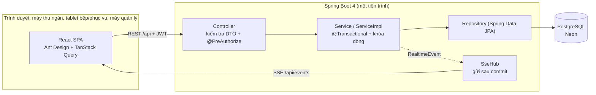
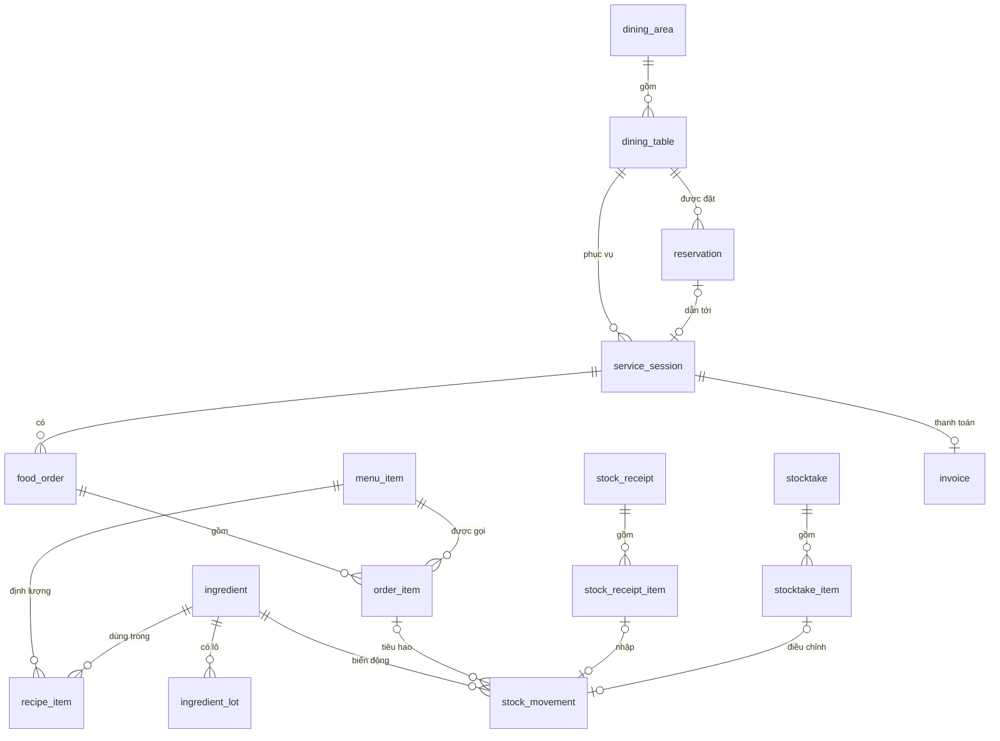
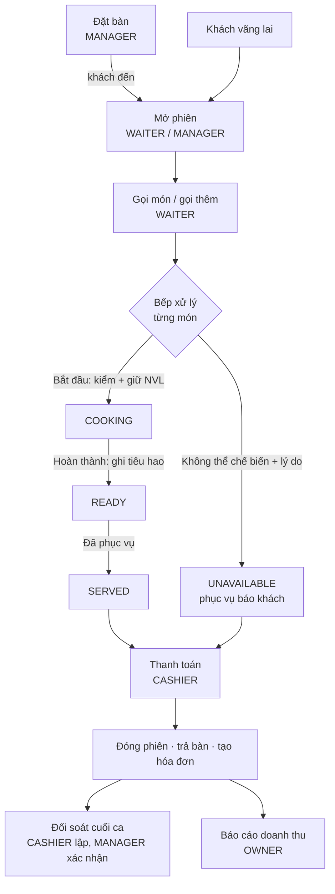
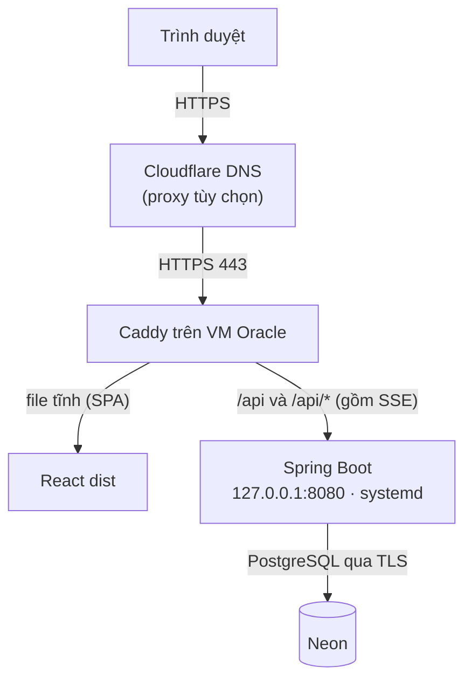

# Quản lý quán ăn phục vụ tại bàn — KLTN UEH

Hệ thống thông tin hỗ trợ **bán hàng tại bàn** và **quản lý nguyên vật liệu (NVL)** cho quán ăn khoảng 30–50 bàn.
Đề tài khóa luận: _“Phân tích, tái thiết kế quy trình nghiệp vụ và xây dựng hệ thống thông tin hỗ trợ vận hành bán hàng
và quản lý nguyên vật liệu cho quán ăn phục vụ tại bàn”_.

> Tài liệu mô tả công nghệ, kiến trúc, nghiệp vụ, cách cài đặt, triển khai và kiểm thử hệ thống.
> Số liệu đo ngày **25/10/2026**.

## Mục lục

1. [Thông tin nhanh](#1-thông-tin-nhanh)
2. [Bài toán, mục tiêu và phạm vi](#2-bài-toán-mục-tiêu-và-phạm-vi)
3. [Chức năng và phân quyền](#3-chức-năng-và-phân-quyền)
4. [Công nghệ sử dụng](#4-công-nghệ-sử-dụng)
5. [Kiến trúc hệ thống](#5-kiến-trúc-hệ-thống)
6. [Dữ liệu và quy tắc nghiệp vụ cốt lõi](#6-dữ-liệu-và-quy-tắc-nghiệp-vụ-cốt-lõi)
7. [Hướng dẫn sử dụng](#7-hướng-dẫn-sử-dụng)
8. [Cài đặt và chạy trên máy phát triển](#8-cài-đặt-và-chạy-trên-máy-phát-triển)
9. [Triển khai (deploy)](#9-triển-khai-deploy)
10. [Kiểm thử và chất lượng](#10-kiểm-thử-và-chất-lượng)
11. [Ưu điểm, nhược điểm và giới hạn](#11-ưu-điểm-nhược-điểm-và-giới-hạn)
12. [Hướng phát triển](#12-hướng-phát-triển)
13. [Cấu trúc mã nguồn](#13-cấu-trúc-mã-nguồn)

---

## 1. Thông tin nhanh

| Hạng mục                     | Nội dung                                                                                                                                                   |
| ---------------------------- | ---------------------------------------------------------------------------------------------------------------------------------------------------------- |
| Loại hệ thống                | Web application nội bộ: React SPA + REST API + SSE, một cơ sở dữ liệu PostgreSQL                                                                           |
| Quy mô thiết kế              | Quán 30–50 bàn, nhiều người dùng nội bộ cùng lúc (6 vai trò)                                                                                               |
| Backend                      | Java 21, Spring Boot 4.1.1, Maven                                                                                                                          |
| Frontend                     | React 19, TypeScript, Vite, **Bun**, Ant Design 6                                                                                                          |
| Cơ sở dữ liệu                | PostgreSQL trên **Neon**; schema do Flyway quản lý (V1–V4), đúng **18 bảng** domain                                                                        |
| Real-time                    | Server-Sent Events (SSE) + TanStack Query invalidation, dự phòng polling 30 giây                                                                           |
| Triển khai                   | Một VM Oracle Cloud (Ubuntu) + Caddy (HTTPS) + systemd + Cloudflare DNS; database ở Neon                                                                   |
| Production                   | https://dnrestaurant.dpdns.org/                                                                                                                            |
| Quy mô code (đếm 25/10/2026) | Backend 175 file Java ≈ 8,3 nghìn dòng, 9 controller, 66 endpoint REST/SSE; frontend 73 file TS/TSX ≈ 4,6 nghìn dòng; test 33 file Java + 10 file frontend |
| Kiểm thử (đo 25/10/2026)     | Backend **266 test** (246 không cần DB + 20 trên PostgreSQL thật); frontend **41 test / 132 assertion**; build và lint đều PASS                            |

---

## 2. Bài toán, mục tiêu và phạm vi

### 2.1 Bài toán

Quán ăn phục vụ tại bàn có nhiều công đoạn nối tiếp nhau: nhận đặt bàn, bố trí bàn, gọi món, chuyển món xuống bếp, phục vụ,
thanh toán, đối soát cuối ca; song song là nhập NVL, theo dõi tồn, hạn sử dụng và kiểm kê. Khi các công đoạn này nằm ở nhiều nơi
(sổ tay, tin nhắn, bảng tính), thông tin gọi món giữa phục vụ và bếp dễ lệch, tồn kho không khớp với món đã bán, và doanh thu
khó đối chiếu. Hệ thống này gom tất cả vào một nền tảng thống nhất.

### 2.2 Mục tiêu (rút từ Business Requirements của khóa luận)

| Mã           | Mục tiêu                                                                                       |
| ------------ | ---------------------------------------------------------------------------------------------- |
| BR-01, BR-02 | Tập trung dữ liệu; số hóa xuyên suốt từ đặt/bố trí bàn đến thanh toán                          |
| BR-03, BR-04 | Phục vụ và bếp thấy cùng một trạng thái món; mọi lần gọi trong một phiên gắn với một phiên/bàn |
| BR-05        | Ghi nhận giao dịch, tổng hợp doanh thu, đối soát theo ca                                       |
| BR-06, BR-07 | Số hóa nhập, tồn, kiểm kê; quản lý lô và hạn sử dụng                                           |
| BR-08, BR-09 | Thông tin tổng hợp cho quản trị; truy xuất giao dịch quan trọng                                |
| BR-10        | Quyền sử dụng theo vai trò                                                                     |
| BR-11        | Liên kết **món bán → định lượng → tiêu hao → biến động tồn**                                   |
| BR-12        | Quản lý tập trung đặt bàn                                                                      |

### 2.3 Phạm vi

| Nhóm                       | Nội dung                                                                                                                                                                                                                                        |
| -------------------------- | ----------------------------------------------------------------------------------------------------------------------------------------------------------------------------------------------------------------------------------------------- |
| **Có**                     | Tài khoản/phân quyền; thực đơn + định lượng; sơ đồ bàn; đặt bàn; phiên phục vụ + gọi món; bếp; phục vụ món; thanh toán + hóa đơn; đối soát cuối ca; danh mục NVL, nhập kho, lô/HSD, tồn, kiểm kê, xuất hủy, biến động; báo cáo OWNER; real-time |
| **Đơn giản hóa**           | Hủy món chỉ khi chờ chế biến; kiểm kê theo NVL (không theo lô); một trang báo cáo; quản lý khu vực/bàn ở mức thêm/sửa/ngừng cho OWNER                                                                                                           |
| **Cắt (hướng phát triển)** | Quên mật khẩu/OTP; sửa thông tin cá nhân; đổi mật khẩu; sửa số lượng món đã gửi bếp; tồn/tiêu hao theo từng lô và FEFO                                                                                                                          |
| **Ngoài phạm vi**          | Khách tự đặt bàn/gọi món online, giao hàng, CRM/loyalty, quản lý nhà cung cấp/PO/công nợ, nhân sự/chấm công, kế toán/hóa đơn điện tử/thuế, đa chi nhánh, app mobile riêng, microservices                                                        |

---

## 3. Chức năng và phân quyền

### 3.1 Chức năng theo module

| Module            | Chức năng chính                                                                                                                                                     |
| ----------------- | ------------------------------------------------------------------------------------------------------------------------------------------------------------------- |
| Xác thực          | Đăng nhập bằng số điện thoại + mật khẩu (BCrypt), JWT, chuyển về trang mặc định theo vai trò                                                                        |
| Tài khoản (OWNER) | Tạo, khóa/mở khóa, đổi vai trò; tìm theo tên/SĐT không dấu; lọc vai trò/trạng thái                                                                                  |
| Thực đơn          | Thêm/sửa/đổi giá, ngừng/kinh doanh lại món; **định lượng** NVL cho từng món (OWNER, HEAD_CHEF)                                                                      |
| Sơ đồ bàn         | Lưới bàn theo khu vực, trạng thái màu, đặt bàn sắp tới, hai badge “món hoàn thành chờ phục vụ” và “món không thể chế biến cần báo khách”; OWNER quản lý khu vực/bàn |
| Đặt bàn           | Tạo (gợi ý bàn phù hợp theo giờ/số khách, chống trùng lịch), sửa, hủy, tra cứu                                                                                      |
| Phiên phục vụ     | Mở phiên (khách vãng lai hoặc gắn đặt bàn), gọi món/gọi thêm, hủy món chờ chế biến, tạm tính                                                                        |
| Bếp               | Hai cột Chờ/Đang chế biến, mỗi đợt gọi là một thẻ; Bắt đầu (kiểm và giữ NVL), Hoàn thành (ghi tiêu hao), Không thể chế biến (bắt buộc lý do)                        |
| Thanh toán        | Xem trước hóa đơn do server tính, tiền mặt/chuyển khoản, đóng phiên và trả bàn trong một giao dịch                                                                  |
| Hóa đơn           | Lịch sử hóa đơn, lọc theo khoảng thời gian và phương thức                                                                                                           |
| Đối soát          | CASHIER lập theo khoảng thời gian (hệ thống tính doanh thu), MANAGER xác nhận                                                                                       |
| Kho               | Danh mục NVL; nhập kho nhiều dòng kèm số lô/HSD; tồn hiện tại, tồn khả dụng/đang giữ; kiểm kê; xuất hủy; lô cần chú ý (sắp/đã hết hạn); lịch sử biến động           |
| Báo cáo (OWNER)   | Doanh thu theo tháng/ngày, số hóa đơn, theo phương thức, top món, ngày cao nhất và bình quân; NVL tồn thấp, lô cần chú ý, 10 biến động mới nhất                     |
| Real-time         | Sơ đồ bàn, bếp, thanh toán, phiên cập nhật không cần tải lại trang                                                                                                  |

### 3.2 Sáu vai trò

| Vai trò                         | Trang mặc định  | Quyền chính                                                                                                                          |
| ------------------------------- | --------------- | ------------------------------------------------------------------------------------------------------------------------------------ |
| `OWNER` — Chủ quán              | `/reports`      | Báo cáo; tài khoản/vai trò; thực đơn, giá; danh mục NVL; quản lý khu vực/bàn; xem kho, hóa đơn, đặt bàn                              |
| `MANAGER` — Quản lý             | `/reservations` | Tạo/sửa/hủy đặt bàn; hỗ trợ mở phiên, gọi món, hủy món; xác nhận đối soát; xem hóa đơn                                               |
| `CASHIER` — Thu ngân            | `/payment`      | Thanh toán, lịch sử hóa đơn, lập đối soát                                                                                            |
| `WAITER` — Phục vụ              | `/floor-plan`   | Xem sơ đồ và đặt bàn; mở phiên; gọi món/gọi thêm; hủy món chờ; xác nhận đã phục vụ; xác nhận đã báo khách khi món không thể chế biến |
| `KITCHEN_STAFF` — Nhân viên bếp | `/kitchen`      | Bắt đầu, hoàn thành, báo không thể chế biến                                                                                          |
| `HEAD_CHEF` — Bếp trưởng        | `/kitchen`      | Mọi chức năng bếp; định lượng món; xem tồn/lô/biến động; nhập kho; kiểm kê; xuất hủy                                                 |

Quyền được kiểm ở **backend** (`@PreAuthorize`); việc ẩn menu ở giao diện chỉ để thuận tiện, không phải lớp bảo mật.
Mỗi endpoint khai báo rõ các vai trò được phép gọi.

---

## 4. Công nghệ sử dụng

### 4.1 Bảng công nghệ

| Lớp                  | Công nghệ                                              | Phiên bản         | Vai trò                                              |
| -------------------- | ------------------------------------------------------ | ----------------- | ---------------------------------------------------- |
| Ngôn ngữ backend     | Java                                                   | 21 (LTS)          | Ngôn ngữ chính                                       |
| Framework            | Spring Boot (Web MVC, Data JPA, Validation)            | 4.1.1             | REST API, ORM, kiểm tra dữ liệu vào                  |
| Bảo mật              | Spring Security + OAuth2 Resource Server               | theo Boot         | JWT HS256 stateless, phân quyền theo vai trò         |
| Migration            | Flyway (+ `flyway-database-postgresql`)                | theo Boot         | Quản lý schema, JPA chỉ `validate`                   |
| Tài liệu API         | springdoc-openapi (Swagger UI)                         | 3.1.0             | Chỉ bật ở profile `local`                            |
| Build/test backend   | Maven wrapper, JUnit 5, Mockito                        | theo Boot         | `mvnw.cmd clean verify`                              |
| Ngôn ngữ frontend    | TypeScript                                             | 6.0               | Kiểu tĩnh cho toàn bộ UI                             |
| UI                   | React                                                  | 19                | Single-page application                              |
| Build frontend       | Vite, **Bun** (package manager + script + test runner) | Vite 8, Bun 1.4.3 | Dev server có proxy `/api`, build tĩnh               |
| Thành phần giao diện | Ant Design (locale `vi_VN`)                            | 6                 | Table, Form, Drawer, Modal, Popconfirm…              |
| Dữ liệu từ server    | TanStack Query                                         | 5                 | Cache, refetch, invalidation                         |
| Định tuyến           | React Router                                           | 7                 | Route có guard theo vai trò                          |
| HTTP                 | Axios                                                  | 1.x               | Gắn JWT, xử lý 401/403                               |
| Real-time client     | @microsoft/fetch-event-source                          | 2.x               | SSE có gửi header `Authorization`                    |
| Ngày giờ             | dayjs                                                  | 1.x               | Hiển thị giờ Việt Nam                                |
| Lint                 | oxlint                                                 | 1.x               | `bun run lint`                                       |
| Cơ sở dữ liệu        | PostgreSQL trên Neon                                   | —                 | Dữ liệu tập trung, giao dịch, ràng buộc              |
| Reverse proxy        | Caddy                                                  | stable            | HTTPS tự động, phục vụ file tĩnh React, proxy `/api` |
| Tiến trình           | systemd                                                | —                 | Chạy và tự khởi động lại backend                     |
| DNS                  | Cloudflare                                             | —                 | Bản ghi trỏ domain về VM (proxy tùy chọn)            |
| Hạ tầng              | Oracle Cloud VM (Ubuntu 22.04/24.04)                   | —                 | Chạy cả frontend tĩnh và backend                     |

Phiên bản chính xác nằm ở [pom.xml](backend/restaurant-management/pom.xml) và [package.json](frontend/package.json).

### 4.2 Vì sao chọn như vậy

| Quyết định                                                    | Lý do                                                                                                                            | Phương án đã loại                                                        |
| ------------------------------------------------------------- | -------------------------------------------------------------------------------------------------------------------------------- | ------------------------------------------------------------------------ |
| Monolith một repo, một tiến trình                             | Phù hợp quy mô 30–50 bàn và thời hạn ngắn; dễ giải thích, dễ triển khai                                                          | Microservices, multi-module, Clean/Hexagonal, CQRS                       |
| Phân lớp Controller → Service → ServiceImpl → Repository      | Mỗi lớp một trách nhiệm; giao dịch và khóa dòng tập trung ở ServiceImpl                                                          | Repository/Service tổng quát (`BaseService<T>`), MapStruct               |
| **SSE** + invalidation                                        | Chỉ cần đẩy một chiều từ server; có sẵn trong Spring MVC, không cần message broker; luôn đọc lại dữ liệu qua REST nên không lệch | WebSocket/STOMP, polling 2–3 giây, Postgres LISTEN/NOTIFY, dịch vụ ngoài |
| JWT stateless                                                 | Không cần lưu phiên phía server; đơn giản khi chỉ có một instance                                                                | Session cookie                                                           |
| Flyway + `ddl-auto: validate`                                 | Schema có phiên bản, kiểm tra được; entity không âm thầm đổi schema                                                              | `ddl-auto: update`                                                       |
| Tồn kho là **sổ cái** (`stock_movement`), không có bảng số dư | Tồn luôn truy vết được; không thể “sửa số” mà không để lại dấu                                                                   | Bảng `stock_balance` cập nhật trực tiếp                                  |
| Neon (PostgreSQL managed)                                     | Không phải tự cài/backup database; hỗ trợ branch                                                                                 | Cài PostgreSQL trên VM, Docker                                           |
| Ant Design + TanStack Query                                   | Có sẵn bảng/form/drawer tiếng Việt; tách rõ state server và state UI                                                             | Redux/Zustand, Tailwind, Next.js                                         |
| Bun                                                           | Cài đặt và chạy script nhanh; một công cụ cho cả test                                                                            | npm/yarn                                                                 |

---

## 5. Kiến trúc hệ thống

### 5.1 Tổng quan



### 5.2 Backend

- **Phân lớp:** `controller → service (interface) → service/impl → repository`.
  Controller chỉ kiểm tra request DTO (Java `record`) và phân quyền; mọi nghiệp vụ, giao dịch, khóa dòng và việc phát sự kiện
  real-time nằm ở `*ServiceImpl`.
- **Entity có hành vi:** các chuyển trạng thái nằm trong entity (ví dụ `OrderItem.markReady()`, `Reservation.confirmSeated()`);
  chuyển trạng thái sai ném `BusinessException` → HTTP 409 kèm thông báo tiếng Việt.
- **Không trả entity ra API:** entity được map thủ công sang response DTO.
- **Quy mô:** 9 controller, 10 service, 18 bảng domain, 66 endpoint.

### 5.3 Frontend

- Mỗi vai trò có route mặc định; route được bảo vệ bằng `RequireAuth` và `RequireRole`; menu sinh từ một bảng điều hướng duy nhất.
- Mỗi trang là một module lazy-load trong `src/pages/<tính năng>/`; truy cập API qua `src/api/*`, kiểu dữ liệu ở `src/types/*`.
- Nhãn trạng thái (enum → tiếng Việt) lấy từ một bản đồ duy nhất `src/utils/labels.ts`; tiền hiển thị bằng `MoneyText`.
- **Không đặt nghiệp vụ ở frontend:** tổng tiền, tồn kho, khả năng thanh toán đều do backend quyết định; UI chỉ hiển thị và gửi yêu cầu.

### 5.4 Real-time bằng SSE

1. `ServiceImpl` phát `RealtimeEvent{type, sessionId}` với `type` là `FLOOR_PLAN`, `RESERVATION` hoặc `ORDER`.
2. Listener `@TransactionalEventListener(AFTER_COMMIT)` chuyển cho `SseHub`, nên client **không bao giờ** nhận tín hiệu cho dữ liệu chưa commit.
3. `SseHub` gửi qua executor riêng (4 worker, hàng đợi 256, không chạy trên luồng của request); lỗi gửi không làm thất bại giao dịch đã commit.
4. Frontend (`useRealtime`) nhận sự kiện và **invalidate** các query tương ứng; dữ liệu luôn được lấy lại qua REST.
5. Dự phòng: mọi màn hình trực tiếp có `refetchInterval` 30 giây và refetch khi focus/reconnect; heartbeat 20 giây giữ kết nối.

### 5.5 Bảo mật

- Mật khẩu: BCrypt, không lưu plaintext. JWT HS256 sống 12 giờ (cấu hình); secret từ biến môi trường, tối thiểu 32 ký tự.
- Người thực hiện thao tác **luôn lấy từ JWT**, không bao giờ từ request body; server không nhận vai trò, tổng tiền, tồn hệ thống,
  doanh thu hệ thống từ client.
- Chỉ `/api/auth/login` (và Swagger ở profile `local`) là công khai. Không cần CORS vì frontend và API cùng origin (Vite proxy khi phát triển, Caddy khi deploy).
- Lỗi trả về dạng `{status, code, message, fieldErrors}`; không lộ stack trace hay SQL.

### 5.6 Toàn vẹn dữ liệu và đồng thời

| Vấn đề                                       | Cách đảm bảo                                                                                                                          |
| -------------------------------------------- | ------------------------------------------------------------------------------------------------------------------------------------- |
| Hai người cùng mở một bàn / đặt trùng giờ    | Khóa dòng `DiningTable` (pessimistic) + kiểm tra trùng lịch trong giao dịch; unique index “một phiên ACTIVE mỗi bàn” làm lưới an toàn |
| Món hoàn thành hai lần không trừ kho hai lần | Khóa Session → OrderItem; unique `CONSUMPTION` theo (món, NVL)                                                                        |
| Hai thao tác kho đồng thời trên cùng NVL     | Mọi thao tác ghi kho khóa `Ingredient` theo ID tăng dần (tránh deadlock)                                                              |
| Thanh toán trùng                             | Khóa `ServiceSession`; unique `invoice.session_id`; lần hai trả 409                                                                   |
| Xác nhận đối soát trùng                      | Khóa dòng đối soát; lần hai trả 409                                                                                                   |
| Yêu cầu lặp                                  | PATCH tới trạng thái đã có trả thành công và không làm gì thêm (idempotent)                                                           |
| Lịch sử                                      | Không xóa cứng dữ liệu lịch sử; khóa ngoại `RESTRICT`; danh mục dùng trạng thái ngừng sử dụng/kinh doanh                              |

---

## 6. Dữ liệu và quy tắc nghiệp vụ cốt lõi

### 6.1 Mô hình dữ liệu (18 bảng)



Bảng `account` liên kết tới các bảng giao dịch qua các cột `*_by_id` (người tạo, thu ngân, quản lý xác nhận, người thực hiện),
và `revenue_reconciliation` liên kết tới `account` hai lần (thu ngân lập, quản lý xác nhận). Sơ đồ trên đã lược các liên kết này cho dễ đọc.

| Nhóm           | Bảng                                                                                                                   |
| -------------- | ---------------------------------------------------------------------------------------------------------------------- |
| Tài khoản      | `account`                                                                                                              |
| Bàn và đặt bàn | `dining_area`, `dining_table`, `reservation`                                                                           |
| Bán hàng       | `service_session`, `food_order`, `order_item`, `invoice`, `revenue_reconciliation`                                     |
| Thực đơn       | `menu_item`, `recipe_item`                                                                                             |
| Kho            | `ingredient`, `ingredient_lot`, `stock_receipt`, `stock_receipt_item`, `stocktake`, `stocktake_item`, `stock_movement` |

Migration: `V1` tạo 18 bảng; `V2` thêm snapshot nguyên liệu giữ chỗ khi bếp bắt đầu món (`order_item.ingredient_requirements`, JSONB);
`V3` thêm xác nhận đã báo khách cho món không thể chế biến; `V4` thêm mã duy nhất cho khu vực và bàn.

### 6.2 Vòng đời trạng thái

```text
Bàn          AVAILABLE ──mở phiên──▶ OCCUPIED ──thanh toán──▶ AVAILABLE      (INACTIVE: ngừng sử dụng)
Đặt bàn      CONFIRMED ──mở phiên──▶ SEATED        |  CONFIRMED ──hủy──▶ CANCELLED
Phiên        ACTIVE ──thanh toán──▶ CLOSED
Món          PENDING ──▶ COOKING ──▶ READY ──▶ SERVED
             PENDING | COOKING ──▶ UNAVAILABLE   (bắt buộc lý do)
             PENDING ──▶ CANCELLED               (chỉ phục vụ/quản lý)
```

### 6.3 Quy tắc nghiệp vụ nổi bật

| Chủ đề                | Quy tắc                                                                                                                                                                                                                                                                                                               |
| --------------------- | --------------------------------------------------------------------------------------------------------------------------------------------------------------------------------------------------------------------------------------------------------------------------------------------------------------------- |
| Tồn kho               | `tồn hiện tại = SUM(quantity_change)` trên `stock_movement`; bốn loại biến động `RECEIPT` (+), `CONSUMPTION` (−), `STOCKTAKE_ADJUSTMENT` (±), `DISPOSAL` (−), mỗi loại có dấu và nguồn cố định (ràng buộc `CHECK`); biến động không bao giờ sửa/xóa                                                                   |
| Giữ chỗ nguyên liệu   | Khi bếp **Bắt đầu** một món: khóa NVL, kiểm `tồn sổ cái − đang giữ − cần dùng`. Âm → chặn; dưới ngưỡng tối thiểu nhưng không âm → cảnh báo và phải xác nhận (kiểm lại lúc xác nhận). Snapshot định lượng được giữ trong lúc nấu; **Hoàn thành** ghi tiêu hao đúng một lần; **Không thể chế biến** giải phóng phần giữ |
| Giá                   | Giá món được chốt vào `order_item.unit_price_at_order` lúc gọi; đổi giá sau đó không ảnh hưởng đơn cũ                                                                                                                                                                                                                 |
| Thanh toán            | Tổng tiền tính lại trên server từ chi tiết món; món `CANCELLED`/`UNAVAILABLE` không tính tiền. Còn món `PENDING`/`COOKING`/`READY` thì chặn thanh toán; phiên 0 đồng vẫn đóng được. Thanh toán, đóng phiên, trả bàn và tạo hóa đơn trong **một giao dịch**                                                            |
| Đặt bàn               | “Còn hiệu lực” = `CONFIRMED` và `endTime > now`; chống trùng lịch (chạm biên không tính trùng); kiểm sức chứa; chỉ sửa đặt bàn `CONFIRMED` chưa gắn phiên; bàn thuộc khu vực ngừng sử dụng không đặt/mở phiên được                                                                                                    |
| Doanh thu và đối soát | Doanh thu chỉ lấy từ `invoice` theo `paid_at` trong `[bắt đầu, kết thúc)`; CASHIER lập, backend tính lại khi lưu, bản chụp không sửa được; MANAGER xác nhận đúng một lần; không cho lập ca ở tương lai                                                                                                                |
| Nhập kho và lô        | Mỗi dòng nhập mới **bắt buộc số lô** (≤ 50 ký tự) và luôn tạo lô mới; hạn sử dụng bắt buộc nếu NVL theo dõi HSD. Số lượng nhập ban đầu của lô là metadata, **không phải số dư theo lô**                                                                                                                               |
| Kiểm kê               | Theo NVL; số hệ thống do backend tính lúc xác nhận; chỉ dòng đã đếm mới được gửi; chênh lệch ≠ 0 mới sinh biến động; không cho số thực đếm thấp hơn lượng đang giữ cho món đang nấu                                                                                                                                   |
| Xuất hủy              | Lý do bắt buộc; số lượng không vượt tồn khả dụng                                                                                                                                                                                                                                                                      |
| Tài khoản             | Khóa tài khoản chặn đăng nhập mới; token đã cấp giữ nguyên vai trò đến khi hết hạn (12 giờ, kể cả khi bị khóa hoặc đổi vai trò); đăng nhập lại để nhận vai trò mới                                                                                                                                                    |

### 6.4 Luồng bán hàng tổng quát



---

## 7. Hướng dẫn sử dụng

### 7.1 Truy cập và đăng nhập

1. Mở https://dnrestaurant.dpdns.org/ (hoặc http://localhost:5173 khi chạy trên máy phát triển).
2. Nhập **Số điện thoại** và **Mật khẩu**, bấm **Đăng nhập**. Hệ thống đưa bạn tới trang mặc định của vai trò.
3. Menu bên trái chỉ hiện các màn hình thuộc vai trò của bạn (trên điện thoại/tablet nhỏ, bấm **Menu**). **Đăng xuất** ở góc trên bên phải.
4. Phiên đăng nhập hết hạn sau 12 giờ; khi đó đăng nhập lại.

**Tài khoản demo** (dữ liệu seed trên cơ sở dữ liệu trống; mật khẩu chung `Demo@123`):

| Số điện thoại | Vai trò       | Trang mặc định  |
| ------------- | ------------- | --------------- |
| 0900000001    | Chủ quán      | `/reports`      |
| 0900000002    | Quản lý       | `/reservations` |
| 0900000003    | Thu ngân      | `/payment`      |
| 0900000004    | Phục vụ       | `/floor-plan`   |
| 0900000005    | Nhân viên bếp | `/kitchen`      |
| 0900000006    | Bếp trưởng    | `/kitchen`      |

> Đổi mật khẩu demo trước khi dùng thật: hệ thống hiện **chưa có** chức năng đổi mật khẩu hay quên mật khẩu (xem [mục 12](#12-hướng-phát-triển)).

Dữ liệu seed khi khởi tạo database trống: 3 khu vực (Tầng 1, Tầng 2, Sân vườn), 12 bàn có mã (ví dụ `T01-B01`), 10 món (phở bò, bún chả,
cơm tấm…), 10 NVL cùng định lượng cho các món, 3 đặt bàn mẫu và phiếu kiểm kê/nhập mở đầu. Trên production không bật seed (`APP_SEED=false`).

> **Cảnh báo bảo mật:** Neon `main` đang là database của bản production **và** là nơi các tài khoản demo trên được seed ban đầu,
> nên bộ số điện thoại/mật khẩu này có thể đăng nhập được vào https://dnrestaurant.dpdns.org/. Hệ thống chưa có chức năng đổi mật khẩu.
> Trước khi công khai repo hoặc địa chỉ trang, hãy tạo tài khoản thật (OWNER → **Tài khoản** → **Tạo tài khoản**) rồi **Khóa** các tài khoản demo
> (khóa chặn đăng nhập mới; token đã cấp vẫn có hiệu lực đến 12 giờ).

### 7.2 Quản lý (MANAGER) — đặt bàn

1. Vào **Đặt bàn**, bấm **Tạo đặt bàn**.
2. Nhập tên khách, số điện thoại, số khách, giờ bắt đầu/kết thúc, ghi chú; bấm **Tìm bàn phù hợp**.
3. Chọn một bàn trong danh sách gợi ý (đã loại bàn ngừng sử dụng, thiếu sức chứa hoặc trùng giờ) rồi lưu.
4. Có thể **Sửa đặt bàn** khi còn _Đã xác nhận_ và chưa nhận bàn, hoặc **Hủy đặt bàn** (có hộp xác nhận). Danh sách lọc theo ngày, trạng thái, tên/SĐT.
5. Quản lý cũng có thể mở phiên, gọi món, hủy món thay phục vụ và xác nhận đối soát (xem 7.5).

### 7.3 Phục vụ (WAITER) — từ sơ đồ bàn đến món ra bàn

1. **Sơ đồ bàn:** mỗi thẻ bàn hiện mã bàn, trạng thái, sức chứa, đặt bàn sắp tới. Chữ “Tự cập nhật trực tiếp” nghĩa là không cần tải lại.
2. Bấm **Mở phiên** trên bàn _Trống_. Chọn **Khách vãng lai (walk-in)** hoặc gắn một đặt bàn đang hiệu lực của bàn đó. Nếu bàn sắp có khách đặt, hệ thống hỏi xác nhận trước khi mở phiên walk-in.
3. Bấm **Xem phiên** để vào chi tiết phiên. Bấm **Gọi món** (lần đầu) hoặc **Gọi thêm**, chọn món đang kinh doanh, số lượng (1–99 mỗi dòng, tối đa 50 dòng mỗi lần), ghi chú, rồi **Gửi bếp**. Mỗi lần gửi tạo một đợt mới.
4. Theo dõi trạng thái từng món. Chỉ món _Chờ chế biến_ mới có nút **Hủy món**.
5. Khi bếp xong món, thẻ bàn hiện badge món hoàn thành: bấm **Đã phục vụ** khi mang món ra.
6. Khi bếp báo _Không thể chế biến_, thẻ bàn hiện badge “cần báo khách” kèm lý do; báo khách rồi xác nhận đã báo.

### 7.4 Bếp (KITCHEN_STAFF, HEAD_CHEF)

1. Màn **Bếp** có hai cột _Chờ chế biến_ và _Đang chế biến_. Mỗi thẻ là một đợt gọi món (một thẻ cho mỗi đợt; nếu đợt có món đang nấu, thẻ nằm ở cột Đang chế biến).
2. Bấm **Xem đợt #…** để mở danh sách món của đợt.
3. Với từng món bấm **Bắt đầu**. Hệ thống kiểm và giữ nguyên liệu theo định lượng:
   - thiếu nguyên liệu → bị chặn, bạn có thể báo **Không thể chế biến**;
   - tồn xuống dưới mức tối thiểu → hiện cảnh báo, chọn **Vẫn tiếp tục chế biến** nếu đồng ý (hệ thống kiểm lại lần nữa).
4. Nấu xong bấm **Hoàn thành**: hệ thống ghi tiêu hao nguyên liệu (đúng một lần) và chuyển món sang _Hoàn thành_ cho phục vụ.
5. Không làm được món: bấm **Không thể chế biến**, nhập lý do (bắt buộc), xác nhận. Nguyên liệu đã giữ được trả lại.
6. Bếp không hủy món; việc hủy thuộc phục vụ/quản lý và chỉ áp dụng cho món chưa bắt đầu.

### 7.5 Thu ngân (CASHIER) — thanh toán và đối soát

**Thanh toán**

1. Vào **Thanh toán**: danh sách phiên đang mở kèm tạm tính. Chọn phiên để xem trước hóa đơn (server tính).
2. Nếu phiên còn món _Chờ chế biến_, _Đang chế biến_ hoặc _Hoàn thành_ (chưa mang ra bàn), hệ thống chặn thanh toán và nói rõ lý do. Món đã phục vụ, đã hủy hoặc không thể chế biến thì không chặn.
3. Chọn **Tiền mặt** hoặc **Chuyển khoản**, bấm **Xác nhận thanh toán**. Phiên đóng, bàn trở về _Trống_, hóa đơn được tạo. Bấm lại lần hai sẽ nhận thông báo đã thanh toán.
4. **Lịch sử hóa đơn**: lọc theo khoảng thời gian và phương thức.

**Đối soát cuối ca**

1. Vào **Đối soát cuối ca**; chọn khoảng thời gian (mặc định từ đầu ngày đến hiện tại; không chọn được tương lai).
2. Xem số liệu hệ thống tính: doanh thu, số hóa đơn, tiền mặt, chuyển khoản.
3. Nhập **Tổng thực nhận (đ)** (nhập 0 được), lý do chênh lệch (không bắt buộc), bấm **Lập đối soát**.
4. **MANAGER** mở cùng màn hình, xem danh sách chưa xác nhận và bấm **Xác nhận**. Đối soát đã xác nhận không sửa được.

### 7.6 Bếp trưởng (HEAD_CHEF) — kho

Mục **Kho** có ba tab:

- **Tồn kho nguyên vật liệu:** tồn hiện tại, khả dụng/đang giữ, tồn tối thiểu, thẻ “tồn thấp” (đỏ nếu âm). Nút **Lô** mở toàn bộ lô của NVL (số lô, hạn, số lượng nhập ban đầu, nhãn Đã hết hạn / Sắp hết hạn / Còn hạn / Không có HSD). Nút **Xuất hủy** để loại bỏ NVL (nhập số lượng và lý do).
- **Lô cần chú ý:** lô đã hoặc sắp hết hạn; chỉnh số ngày cảnh báo (0–90, mặc định 7).
- **Lịch sử biến động kho:** lọc theo NVL, loại biến động, thời gian; có nguồn (phiên/phiếu nhập/phiếu kiểm kê) và người thực hiện.

**Nhập kho** (`Nhập nguyên vật liệu`): thêm từng dòng bằng **Thêm dòng**: chọn NVL, **Số lượng nhập**, **Số lô** (bắt buộc), **Hạn sử dụng** (bắt buộc nếu NVL theo dõi HSD), rồi **Lưu phiếu**. Cả phiếu lưu cùng lúc hoặc không lưu gì.

**Kiểm kê:** bảng liệt kê NVL đang dùng; các ô _thực đếm_ ban đầu **để trống**. Chỉ điền cho NVL đã đếm (để trống = không kiểm). Nút **Khớp tồn hệ thống** của từng dòng điền nhanh số đang hiển thị. Bấm **Xác nhận kiểm kê**: hệ thống tính lại tồn thực tế tại thời điểm xác nhận và chỉ ghi điều chỉnh cho dòng có chênh lệch.

**Định lượng món:** vào **Thực đơn**, bấm **Định lượng** ở một món, thêm/sửa/xóa dòng NVL và lượng cho mỗi phần rồi **Lưu định lượng**. Thay đổi chỉ áp dụng cho các món chưa được bếp bắt đầu.

### 7.7 Chủ quán (OWNER)

- **Báo cáo:** chọn tháng, khoảng ngày hoặc nhanh **7 ngày qua** / **Tháng này**; xem doanh thu, số hóa đơn, theo phương thức, bảng theo ngày, ngày cao nhất, bình quân/ngày, top món bán; bên dưới là NVL tồn thấp, lô cần chú ý và 10 biến động mới nhất.
- **Tài khoản:** **Tạo tài khoản**; tìm theo tên/SĐT (không phân biệt dấu); lọc vai trò/trạng thái; **Khóa**/**Mở khóa**; đổi vai trò. Không tự khóa hoặc đổi vai trò của chính mình.
- **Thực đơn:** **Thêm món**, **Sửa** (tên, giá), **Ngừng kinh doanh** / **Kinh doanh lại**. Món mới hiện đầu danh sách; món đang bán luôn xếp trước món đã ngừng.
- **Kho:** thêm/sửa/ngừng sử dụng NVL (không đổi đơn vị tính khi NVL đã có biến động).
- **Sơ đồ bàn:** nút **Quản lý khu vực và bàn** mở bảng quản lý hai tab Khu vực/Bàn: thêm, sửa, **Ngừng sử dụng**, **Sử dụng lại**. Không xóa cứng. Không ngừng được bàn đang phục vụ hoặc còn đặt bàn hiệu lực.

### 7.8 Kịch bản demo end-to-end (gợi ý, khoảng 10 phút)

1. **MANAGER** tạo một đặt bàn cho 4 khách vào giờ sắp tới.
2. **WAITER** mở phiên cho bàn đó (gắn đặt bàn), gọi 2–3 món → **Gửi bếp**.
3. **KITCHEN_STAFF** (trình duyệt khác) thấy thẻ mới ngay lập tức; **Bắt đầu** rồi **Hoàn thành** món; thử **Không thể chế biến** với một món khác.
4. **WAITER** thấy badge trên thẻ bàn thay đổi; bấm **Đã phục vụ**, xác nhận đã báo khách cho món không làm được.
5. **HEAD_CHEF** mở **Kho**: tồn các NVL của món vừa nấu đã giảm; xem **Lịch sử biến động kho** có dòng _Tiêu hao chế biến_.
6. **CASHIER** thanh toán phiên bằng tiền mặt; bàn trở về _Trống_; xem hóa đơn trong **Lịch sử hóa đơn**.
7. **CASHIER** lập đối soát cho ca; **MANAGER** xác nhận.
8. **OWNER** mở **Báo cáo** thấy doanh thu và món bán chạy.

> Kịch bản tạo dữ liệu thật. Trên production, hãy dùng môi trường riêng cho demo (xem [mục 9.6](#96-an-toàn-dữ-liệu-production)).

---

## 8. Cài đặt và chạy trên máy phát triển

### 8.1 Yêu cầu

| Công cụ                 | Ghi chú                                                                                                                       |
| ----------------------- | ----------------------------------------------------------------------------------------------------------------------------- |
| JDK **21**              | Đặt `JAVA_HOME` về JDK 21. Dự án đặt `java.version` 21; trên máy phát triển hiện tại biến mặc định đang là JDK 17 nên cần đổi |
| Bun                     | Phiên bản theo `packageManager` trong `frontend/package.json` (hiện 1.4.3). **Không dùng npm**                                |
| Git, PowerShell         | Lệnh trong tài liệu dùng PowerShell (Windows)                                                                                 |
| Một database PostgreSQL | Dự án dùng **Neon**; không cần Docker hay PostgreSQL cài trên máy                                                             |

### 8.2 Cấu hình backend

Cấu hình đọc từ biến môi trường hoặc file `backend/restaurant-management/application-local.yaml` (đã được `.gitignore`,
không bị đóng gói vào JAR). Mẫu: [application-local.example.yaml](backend/restaurant-management/application-local.example.yaml).

| Biến                         | Ý nghĩa                                                                                                                             |
| ---------------------------- | ----------------------------------------------------------------------------------------------------------------------------------- |
| `DB_URL`                     | JDBC URL, dùng endpoint **direct** của Neon (host **không** có `-pooler`) vì Flyway dùng advisory lock, không chạy ổn qua PgBouncer |
| `DB_USERNAME`, `DB_PASSWORD` | Tài khoản database                                                                                                                  |
| `JWT_SECRET`                 | Chuỗi ngẫu nhiên tối thiểu 32 ký tự                                                                                                 |

Cấu hình chính (`application.yaml`): múi giờ `Asia/Ho_Chi_Minh`; JWT hết hạn sau 12 giờ; cảnh báo hết hạn mặc định 3 ngày (API) —
giao diện kho dùng 7 ngày; cảnh báo đặt bàn sắp tới trong 60 phút; Hikari tối đa 5 kết nối; `app.seed=true` (tắt ở production).

> **Quan trọng:** khởi động backend sẽ chạy Flyway và (khi `app.seed=true`) seed dữ liệu vào database được cấu hình.
> **Đừng trỏ môi trường phát triển vào database production.** Hãy dùng một database hoặc branch riêng
> (Neon hỗ trợ tạo branch riêng cho phát triển).
> Không đưa mật khẩu, secret hay token vào Git, tài liệu hay log chia sẻ.

### 8.3 Chạy backend

```powershell
cd backend\restaurant-management
# Chỉ tạo file nếu chưa có; không ghi đè cấu hình hiện có:
# Copy-Item application-local.example.yaml application-local.yaml
$env:JAVA_HOME = 'C:\Program Files\Java\jdk-21.0.11'   # đổi theo máy của bạn
.\mvnw.cmd spring-boot:run '-Dspring-boot.run.profiles=local'
```

API tại http://localhost:8080/api; Swagger UI (chỉ profile `local`) tại http://localhost:8080/swagger-ui.html —
đăng nhập `POST /api/auth/login`, lấy `accessToken` rồi bấm **Authorize**.

Khi database trống, các bộ seed chạy theo thứ tự: `DataSeeder` (tài khoản, khu vực, bàn) → `PhaseOneSeeder` (món, NVL, định lượng, đặt bàn mẫu)
→ `PhaseThreeSeeder` (kiểm kê mở đầu rồi phiếu nhập mẫu có lô/HSD). Mỗi bộ có điều kiện riêng, chạy trong giao dịch và **không ghi đè** dữ liệu có sẵn.

### 8.4 Chạy frontend

```powershell
cd frontend
bun install
bun run dev        # http://localhost:5173, Vite proxy /api -> http://localhost:8080
```

### 8.5 Build, lint, test

```powershell
# Backend (JDK 21)
cd backend\restaurant-management
.\mvnw.cmd clean verify                                              # build + toàn bộ test
.\mvnw.cmd test '-Dtest=ReservationServiceImplTest#rejectsOverlap'   # một test

# Frontend
cd frontend
bun run build      # tsc -b + vite build
bun run lint       # oxlint
bun run test       # bun test tests
```

Test tích hợp trên PostgreSQL thật (`IssuesPostgresTest`: tranh chấp đồng thời, rollback, idempotency, HTTP đầu-cuối) chỉ chạy khi đặt
`KLTN_TEST_DB_URL`; guard chỉ chấp nhận PostgreSQL trên máy cục bộ với database `kltn_issues_test` và dùng schema ngẫu nhiên cho mỗi lượt.
Dùng `scripts\test-issues-postgres.ps1` để chạy toàn bộ với JDK 21. Không đặt biến này thì các test đó bị bỏ qua, nên `clean verify` xanh
chưa chứng minh phần tranh chấp đồng thời.

---

## 9. Triển khai (deploy)

### 9.1 Mô hình triển khai



| Thành phần      | Cách chạy                                                                                                                      |
| --------------- | ------------------------------------------------------------------------------------------------------------------------------ |
| Frontend        | Build thành file tĩnh (`dist`), Caddy phục vụ; fallback `index.html` để F5 ở mọi route vẫn vào React Router                    |
| Backend         | `java -jar` dưới systemd, chỉ nghe `127.0.0.1:8080` (không mở ra Internet); heap `-Xms128m -Xmx512m`; tự khởi động lại khi lỗi |
| HTTPS           | Caddy cấp chứng chỉ tự động (Let’s Encrypt); khi cài đặt để Cloudflare ở chế độ _DNS only_, chạy ổn rồi mới bật proxy          |
| Database        | Neon (endpoint direct), kết nối từ VM qua TLS; không mở cổng PostgreSQL trên VM                                                |
| Cấu hình bí mật | File môi trường `/etc/dnrestaurant/backend.env` (quyền 600): `DB_URL`, `DB_USERNAME`, `DB_PASSWORD`, `JWT_SECRET`              |
| Profile         | `SPRING_PROFILES_ACTIVE=prod`, `APP_SEED=false` (không seed ở production), múi giờ `Asia/Ho_Chi_Minh`                          |
| Firewall        | Mở TCP 80/443 ở cả Oracle Security List/NSG và firewall Ubuntu (cộng SSH để quản trị)                                          |

### 9.2 Quy trình triển khai một bản mới

Script chạy **từ máy Windows** chứa repo, lấy nội dung working tree hiện tại (kể cả thay đổi chưa commit, nên phải tự kiểm tra
đây đúng là bản muốn đưa lên):

```powershell
Set-ExecutionPolicy -Scope Process -ExecutionPolicy Bypass
.\scripts\deploy-oracle.ps1                      # SSH alias mặc định: dnrestaurant-oracle
.\scripts\deploy-oracle.ps1 -SshAlias <alias>    # dùng alias khác
# Khóa SSH nằm trong WSL:
.\scripts\deploy-oracle-wsl.ps1 -UseWslSsh -WslKeyPath '<khóa-trong-WSL>' -WslRemote '<user>@<host>'
```

Script thực hiện: kiểm tra công cụ → build/test/lint → đóng gói JAR và `dist` → upload một **release** mới (thư mục có ID theo thời gian)
→ đổi symlink `current` → restart service → kiểm tra backend. Khi backend restart, API gián đoạn trong thời gian ngắn
(triển khai một instance). Flyway tự chạy migration khi backend khởi động.

### 9.3 Cập nhật và quay lại bản trước (rollback)

- Mỗi lần deploy giữ nguyên các release cũ trên đĩa; `previous` trỏ tới bản chạy trước đó.
- Rollback JAR và file frontend: `sudo /usr/local/sbin/dnrestaurant-release rollback <release-id>`.
- **Rollback không hoàn tác schema hay dữ liệu.** Khi có migration mới, phải kiểm JAR cũ còn tương thích; sao lưu/khôi phục database là thao tác riêng (mục 9.5).

### 9.4 Kiểm tra sau triển khai và vận hành

- Giao diện mở được, đăng nhập được; `/api` trả đúng; SSE kết nối qua HTTPS; F5 tại route sâu (ví dụ `/floor-plan`) vẫn vào ứng dụng.
- Khởi động lại VM: service tự lên (đã bật `enable`).
- Xem log: `sudo journalctl -u dnrestaurant -n 100 --no-pager`; xem bản đang chạy: `readlink -f /srv/dnrestaurant/current`; theo dõi dung lượng đĩa (`df -h /`).

### 9.5 Sao lưu và khôi phục (TR-09)

Dữ liệu nằm ở Neon. Hướng dẫn có sẵn **không đồng nghĩa đã diễn tập khôi phục** (chưa thực diễn, xem mục 11). Có hai cách:
dùng tính năng branch/restore của Neon, hoặc `pg_dump` bằng endpoint direct:

```powershell
pg_dump '<neon-direct-connection-uri>' -Fc -f backup.dump
pg_restore --clean --no-owner -d '<neon-direct-connection-uri>' backup.dump
```

`pg_restore --clean` **thay thế** các đối tượng của database đích: chỉ chạy khi đã xác định đúng phạm vi và đúng đích. Dùng client PostgreSQL
tương thích với phiên bản server. Giữ file `.dump` và thông tin kết nối ngoài Git.

### 9.6 An toàn dữ liệu production

Neon `main` hiện là **database production** (dữ liệu thật của bản đang chạy). Do đó:

- Không chạy kiểm thử ghi dữ liệu, reset hoặc seed lại lên `main`.
- Kiểm thử cần ghi dữ liệu dùng PostgreSQL cục bộ (mục 8.5).
- Chuẩn bị demo bằng cách tạo giao dịch mới qua đúng workflow, không sửa lịch sử hay làm mới ngày của dữ liệu mẫu.

---

## 10. Kiểm thử và chất lượng

### 10.1 Kết quả đo ngày 25/10/2026

Chạy trên mã nguồn hiện tại, **không ghi vào Neon** (không đặt `DB_*`, `JWT_SECRET`):

| Kiểm tra                                       | Kết quả                                                                           |
| ---------------------------------------------- | --------------------------------------------------------------------------------- |
| Backend `clean verify` (JDK 21) + đóng gói JAR | **266 test**, 0 lỗi, 0 bỏ qua; BUILD SUCCESS (≈ 52 giây)                          |
| — gồm                                          | 246 test không cần database + 20 test `IssuesPostgresTest` trên PostgreSQL cục bộ |
| Frontend `bun run test`                        | **41 test / 132 assertion**, 0 lỗi                                                |
| Frontend `bun run lint`, `bun run build`       | PASS, PASS                                                                        |

### 10.2 Các loại kiểm thử

| Loại                        | Nội dung                                                                                                                                   | Công cụ                                      |
| --------------------------- | ------------------------------------------------------------------------------------------------------------------------------------------ | -------------------------------------------- |
| Unit test service/entity    | Quy tắc nghiệp vụ: chuyển trạng thái, trùng lịch, giá snapshot, tồn, khóa theo thứ tự                                                      | JUnit 5 + Mockito                            |
| Test bảo mật                | Ma trận 6 vai trò × endpoint, 401/403, validation đầu vào                                                                                  | Spring Security test, MockMvc                |
| Test realtime               | SseHub, listener sau commit, map sự kiện → query key                                                                                       | JUnit, bun test                              |
| Test trên PostgreSQL thật   | Tranh chấp đồng thời (mở phiên/đặt bàn/ngừng khu vực, tiêu hao, nhập, kiểm kê, xuất hủy, thanh toán), rollback, idempotency, HTTP đầu-cuối | JUnit + PostgreSQL cục bộ, schema ngẫu nhiên |
| Test tiện ích frontend      | Giới hạn gọi món, nhóm hàng đợi bếp, ngày trong báo cáo, lọc tài khoản, thời gian đối soát, thanh toán, invalidation                       | `bun test`                                   |
| Kiểm thử giao diện thủ công | Chrome và Edge, viewport desktop/tablet                                                                                                    | Trình duyệt                                  |

### 10.3 Chưa được kiểm chứng

- **Thiết bị tablet vật lý** (mới kiểm viewport tablet trên trình duyệt desktop).
- **Nhiều người dùng đồng thời / tải thực tế** (chưa benchmark).
- **Diễn tập khôi phục từ backup** (hướng dẫn có, chưa thực diễn).
- Kiểm thử ghi trên ứng dụng production không được thực hiện (xem mục 9.6).

---

## 11. Ưu điểm, nhược điểm và giới hạn

### 11.1 Ưu điểm

| Ưu điểm                                   | Căn cứ                                                                                                                   |
| ----------------------------------------- | ------------------------------------------------------------------------------------------------------------------------ |
| **Đơn giản, dễ bảo trì và dễ giải thích** | Monolith một tiến trình; phân lớp rõ; 9 controller, 10 service; không broker, không microservices                        |
| **Truy vết kho chặt chẽ**                 | Sổ cái `stock_movement` chỉ thêm, không sửa/xóa; mỗi biến động có nguồn và người thực hiện; không bảng số dư để “sửa số” |
| **Liên kết bán hàng với kho**             | Định lượng → giữ chỗ lúc bếp bắt đầu → tiêu hao đúng một lần lúc hoàn thành → cảnh báo tồn thấp/HSD (đáp ứng BR-11)      |
| **Đúng trong điều kiện tranh chấp**       | Khóa dòng bi quan theo thứ tự cố định + unique index; 20 test trên PostgreSQL thật; thao tác lặp là idempotent           |
| **Số tiền và quyền do server quyết định** | Giá chốt lúc gọi; tổng tiền tính lại ở server; người thao tác lấy từ JWT; quyền kiểm ở backend                           |
| **Real-time nhẹ nhưng đáng tin**          | SSE chỉ báo “có thay đổi” sau commit, dữ liệu lấy lại qua REST; có polling 30 giây dự phòng                              |
| **Chi phí hạ tầng thấp, triển khai gọn**  | Một VM + Neon managed; deploy bằng một script; có release và rollback JAR/frontend                                       |
| **Phân quyền theo vai trò rõ ràng**       | 6 vai trò, trang mặc định riêng, giao diện chỉ hiện những gì được phép                                                   |
| **Giao diện tiếng Việt, nhãn nhất quán**  | Một bản đồ nhãn dùng chung; Popconfirm cho thao tác không hoàn tác; bố cục ưu tiên tablet cho bếp/phục vụ                |

### 11.2 Nhược điểm và giới hạn

| Hạn chế                                            | Ảnh hưởng / ghi chú                                                                                                                                                                       |
| -------------------------------------------------- | ----------------------------------------------------------------------------------------------------------------------------------------------------------------------------------------- |
| **Một instance**                                   | Restart backend làm API gián đoạn ngắn; danh sách kết nối SSE lưu trong bộ nhớ nên chưa mở rộng ngang được (cần bổ sung cơ chế khác nếu chạy nhiều instance); VM đơn là điểm lỗi duy nhất |
| **JWT không thu hồi được**                         | Khóa tài khoản hoặc đổi vai trò chỉ có hiệu lực khi đăng nhập lại; token cũ giữ quyền tối đa 12 giờ. Token lưu ở `localStorage` (chấp nhận cho prototype)                                 |
| **Phụ thuộc database ở xa**                        | Mỗi truy vấn đi qua mạng tới Neon; với gói free, compute tự suspend nên request đầu sau thời gian rảnh có thể chậm (ước khoảng 1 giây, chưa đo trên production)                           |
| **Chưa có CI/CD**                                  | Build, test và deploy chạy thủ công từ một máy Windows; không có pipeline tự động chặn thay đổi lỗi                                                                                       |
| **Kiểm thử giao diện chưa tự động hóa**            | Giao diện được kiểm thủ công; chưa có bộ kiểm thử E2E tự động                                                                                                                             |
| **Chưa nghiệm thu một số điều kiện thực tế**       | Tablet vật lý, tải nhiều người dùng, diễn tập khôi phục (xem 10.3)                                                                                                                        |
| **Phạm vi bị cắt**                                 | Không có quên mật khẩu/OTP, sửa hồ sơ, **đổi mật khẩu**; không sửa số lượng món đã gửi bếp; không tồn/tiêu hao theo lô và FEFO (lô chỉ là metadata)                                       |
| **Báo cáo kho là trạng thái hiện tại**             | Chưa có báo cáo kho theo kỳ hay xu hướng; báo cáo doanh thu chỉ từ hóa đơn                                                                                                                |
| **Truy vết dựa vào cột người/thời điểm**           | Không có bảng nhật ký audit tổng quát (đúng 18 bảng); không ghi lại mọi thay đổi trường dữ liệu danh mục                                                                                  |
| **Tồn âm lịch sử được giữ nguyên**                 | Dữ liệu âm phát sinh trước các quy tắc chặn mới không bị tự sửa; hệ thống chỉ ngăn phát sinh thêm ở luồng bếp mới                                                                         |
| **Rollback không hoàn tác dữ liệu**                | Chỉ đưa JAR/frontend về bản cũ; schema và dữ liệu cần sao lưu/khôi phục riêng                                                                                                             |
| **Dữ liệu demo và production dùng chung database** | Hiện chỉ có Neon `main`; cần tách database/branch cho demo và phát triển để tránh ghi nhầm                                                                                                |
| **Tích hợp ngoài**                                 | Chưa có thanh toán điện tử/QR, in hóa đơn hay in phiếu bếp, hóa đơn điện tử/thuế                                                                                                          |

---

## 12. Hướng phát triển

Đề xuất, sắp xếp theo giá trị và độ khả thi:

1. **Bảo mật tài khoản:** đổi mật khẩu (ưu tiên số 1), quên mật khẩu/OTP, sửa hồ sơ; cơ chế thu hồi token hoặc refresh token ngắn hạn.
2. **Vận hành:** tách database/branch cho phát triển – demo – production; CI/CD (build, test, lint, kiểm migration); diễn tập backup/restore định kỳ; giám sát và cảnh báo.
3. **Kiểm thử:** bộ E2E tự động chạy trên môi trường tách biệt; kiểm tải nhiều người dùng; kiểm trên tablet thật tại quán.
4. **Kho nâng cao:** tồn và tiêu hao theo lô, FEFO; báo cáo kho theo kỳ; đề xuất nhập hàng khi tồn thấp.
5. **Bán hàng:** thanh toán QR/POS, in hóa đơn và phiếu bếp, sửa số lượng món đã gửi bếp có kiểm soát, chia/gộp hóa đơn.
6. **Mở rộng quy mô:** nhiều chi nhánh; nhiều instance backend (khi đó cần cơ chế phát sự kiện dùng chung thay cho registry trong bộ nhớ).

---

## 13. Cấu trúc mã nguồn

```text
.
├─ backend/restaurant-management/     Spring Boot (Java 21, Maven wrapper)
│  └─ src/main/java/vn/ueh/kltn/restaurant/
│     ├─ controller/  service/ + service/impl/  repository/  entity/  dto/  mapper/
│     ├─ config/ (Security, JWT, SSE executor)  security/  realtime/  seed/  enums/  exception/  validation/
│  └─ src/main/resources/db/migration/   V1–V4 (Flyway)
├─ frontend/                          React + TypeScript + Vite (Bun)
│  └─ src/  pages/  components/  api/  types/  auth/  realtime/  layouts/  utils/  tests/ (ngoài src)
├─ scripts/                           Script triển khai và chạy test trên PostgreSQL cục bộ
└─ README.md                          Tài liệu này
```

**Quy ước đặt tên:** mã định danh trong code (lớp, bảng, cột, enum, URL, route, query key) dùng tiếng Anh; chữ hiển thị, thông báo lỗi và dữ liệu seed là tiếng Việt có dấu.
Bảng, cột `snake_case` số ít; REST dùng danh từ số nhiều kebab-case, kèm động từ cho đổi trạng thái (ví dụ `/api/reservations/{id}/cancel`).
Tên trong ERD/Class Diagram của khóa luận (ví dụ `Ban`, `DonGoiMon`, `PhienPhucVu`, `BienDongKho`) tương ứng `DiningTable`, `FoodOrder`, `ServiceSession`, `StockMovement`.
